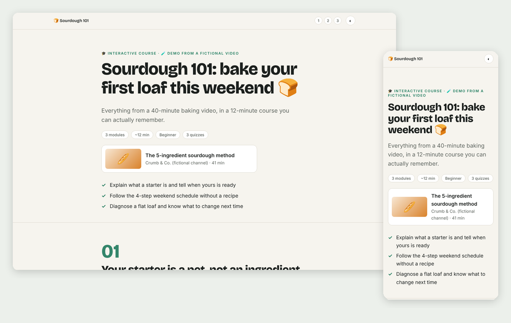
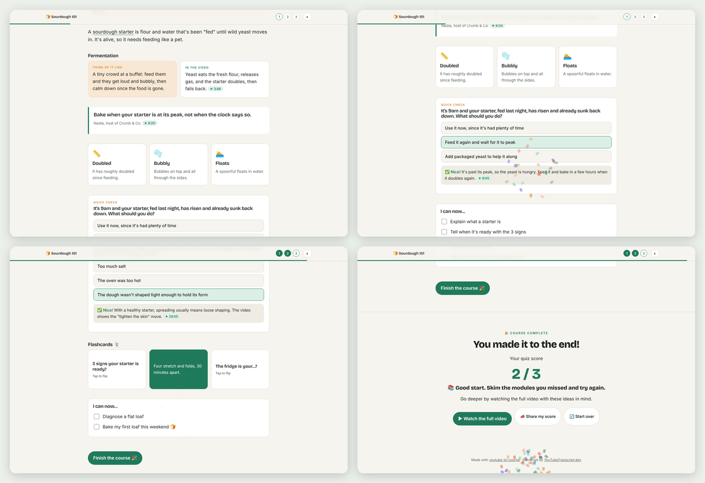

<div align="center">

# 🎓 YouTube to Course

### Turn any YouTube video into an interactive course. Quizzes, flashcards, confetti. 🎉

[](LICENSE)
[](#-get-started-in-60-seconds)
[](#-get-started-in-60-seconds)



**Learn a 1-hour video in 15 minutes, and actually remember it.** 🧠
<br>Lectures, tutorials, podcasts, and talks become bite-sized lessons with quizzes that check you really get it.

</div>

---

## ✨ What you get

One HTML file. Open it in any browser, on any device. No app, no login, no LMS.

| | |
|---|---|
| 🧩 **Bite-sized modules** | 3–6 short modules that follow the ideas, not just the video's running order |
| 🪄 **Metaphor first** | Every concept starts with an everyday comparison, then shows what the speaker said |
| ✅ **Quizzes that make you think** | Real-life scenarios, instant feedback, and 🎉 confetti when you nail it |
| 🃏 **Flip flashcards** | Tap to flip, perfect for quick review |
| 💬 **Hover definitions** | Jargon gets a plain-English tooltip |
| ⏱️ **Timestamp links** | Every key claim jumps to that second of the video |
| 📈 **Progress & score** | Progress bar, module dots, "I can now…" checklists, and a final score, saved on your device |
| 📣 **Share your score** | One tap to brag 😄 |
| 🌗 **Light & dark mode** | Mobile-friendly and printable |



👉 **[See the full example course](examples/sourdough-101.html)** (download it and open in your browser): *Sourdough 101*, built from a fictional baking video. Try the quizzes!

---

## 🚀 Get started in 60 seconds

### Option 1: Claude Code (desktop app, web, or terminal) ⭐ recommended

Type this into Claude Code:

```
/plugin install youtube-to-course --marketplace tstfully/youtube-to-course
```

Done! 🎉 You also get access to the companion skills ([case study](https://github.com/tstfully/youtube-to-case-study) and [AI chat](https://github.com/tstfully/youtube-to-ai-chat)).

<details>
<summary>Other ways to install</summary>

**Ask Claude to do it.** Paste this into Claude Code (or any coding agent):

> Install the youtube-to-course skill from https://github.com/tstfully/youtube-to-course, then help me connect a free YouTubeTranscript.dev API key without me pasting the key into this chat.

**Two-step plugin install** (older Claude Code versions):

```
/plugin marketplace add tstfully/youtube-to-course
/plugin install youtube-to-course@youtube-skills
```

**Skills CLI** (works with Claude Code, Cursor, Codex, and other agents):

```bash
npx skills add tstfully/youtube-to-course
```

**Manual:**

```bash
git clone https://github.com/tstfully/youtube-to-course ~/.claude/skills/youtube-to-course
```

</details>

### Option 2: Claude.ai (no install at all)

1. Click the green **Code** button above → **Download ZIP**.
2. In Claude.ai, go to **Settings → Capabilities → Skills → Upload skill** and choose the ZIP.
3. Grab a transcript for free at [youtubetranscript.dev/tools/transcript](https://www.youtubetranscript.dev/tools/transcript), paste it into the chat, and say *"turn this into a course"*.

### 🔑 Connect transcripts (free, once)

| | How | Best for |
|---|---|---|
| 📋 **Paste it** | Copy a transcript from the [free tool](https://www.youtubetranscript.dev/tools/transcript) and paste it in | Trying it out, Claude.ai |
| 🔑 **API key** | Get a free key at [youtubetranscript.dev](https://youtubetranscript.dev) (**Dashboard → API Keys**) and save it as `YOUTUBETRANSCRIPT_API_KEY`. Claude can walk you through it. | Using it often |
| 🔌 **MCP server** | `claude mcp add --transport http youtubetranscript https://mcp.youtubetranscript.dev --header "x-api-token: YOUR_API_KEY"` | Claude Code, Claude Desktop, Cursor |

The free plan includes **10 videos a month**, no credit card. Videos without captions can be transcribed from the audio too.

> 🔒 **Never paste an API key into a chat**, a screenshot, or a shared doc. Type it into your settings yourself.

---

## 💬 Just ask

Copy, paste, and swap in your link:

| You are… | Try this |
|---|---|
| 🎓 **A student** | *"I have an exam Friday. Turn this lecture into a course with lots of quizzes: [link]"* |
| 🍎 **A teacher** | *"Make a beginner lesson from this video for my 10th graders, plus a lesson plan: [link]"* |
| 🏢 **A trainer / HR** | *"Turn this talk into an onboarding module for new hires: [link]"* |
| 🧭 **A PM or team lead** | *"Make a 10-minute course from this conference talk so my team gets the key ideas: [link]"* |
| 📣 **A marketer** | *"Course from these 3 videos on SEO, for a beginner: [link] [link] [link]"* |
| 🌍 **A language learner** | *"Make the course in Spanish from this English video: [link]"* |

**Bonus asks:** 🌶️ *"Make it harder"* · 📝 *"Give me a one-page cheat sheet"* · 🏁 *"Add a final exam"* · 🍎 *"Write a 45-minute lesson plan"*

---

## ❓ FAQ

<details>
<summary><b>Do I need to know how to code?</b></summary>
Nope. You ask in plain English and get a file you double-click to open.
</details>

<details>
<summary><b>Is it really free?</b></summary>
The skill is free and open source (MIT). Transcripts are free for 10 videos a month on YouTubeTranscript.dev, or free anytime if you paste the transcript yourself. You need Claude (Claude.ai, Claude Code, or another AI agent) to run it.
</details>

<details>
<summary><b>Can I share the course with students or my team?</b></summary>
Yes! Send the HTML file, put it in Google Drive or your LMS, or host it on any website. Everyone's progress is saved privately in their own browser.
</details>

<details>
<summary><b>Will it make things up?</b></summary>
It's built not to. The course only teaches what the video says, and every key claim links to its timestamp so you can check it.
</details>

<details>
<summary><b>Can it use more than one video?</b></summary>
Yes. Paste several links and they become one course.
</details>

<details>
<summary><b>What languages work?</b></summary>
Any video with captions in 100+ languages, and the course can be written in whatever language you ask for.
</details>

---

## 🤖 For AI agents

If you are an AI agent helping a user with this repo:
- **Install (Claude Code):** `/plugin install youtube-to-course --marketplace tstfully/youtube-to-course`, or copy this folder to `~/.claude/skills/youtube-to-course`.
- **Entry point:** [`SKILL.md`](SKILL.md). Follow it step by step.
- **Transcript:** use the `youtubetranscript` MCP server if connected, else `scripts/fetch-transcript.mjs` with `YOUTUBETRANSCRIPT_API_KEY`, else ask the user to paste one from https://www.youtubetranscript.dev/tools/transcript. Never ask for API keys in chat.
- **Summary for LLMs:** [`llms.txt`](llms.txt)

<details>
<summary>📁 What's inside</summary>

```
youtube-to-course/
├── SKILL.md                      # Step-by-step instructions the AI follows
├── assets/template.html          # Course template: all CSS + JS built in
├── references/
│   ├── course-design.md          # Teaching principles: outcomes, modules, quizzes
│   └── components.md             # Every building block, ready to fill in
├── scripts/fetch-transcript.mjs  # Fetches transcripts (no dependencies)
├── examples/                     # Finished example course
├── llms.txt                      # Summary for AI agents and search
└── .claude-plugin/               # One-command install for Claude Code
```

</details>

---

## 💛 More free YouTube skills

| | |
|---|---|
| 📊 [**youtube-to-case-study**](https://github.com/tstfully/youtube-to-case-study) | Turn any video into a business, marketing, or UX case-study slideshow |
| 💬 [**youtube-to-ai-chat**](https://github.com/tstfully/youtube-to-ai-chat) | Chat with any video, with answers cited to the second |

**Powered by [YouTubeTranscript.dev](https://youtubetranscript.dev):** YouTube transcripts in 100+ languages, AI transcription for videos without captions, and [free tools](https://www.youtubetranscript.dev/tools) with no login.

<sub>MIT licensed · ⭐ Star the repo if it helped you learn something!</sub>
